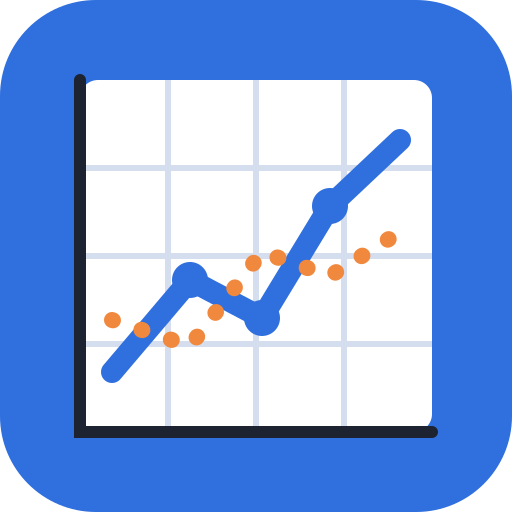

<p align="center"></p>

# GraphDesigner – Diagramm-Designer

Tabelle einfügen → Diagramm gestalten → als PNG, SVG, PDF oder für Word exportieren.

Der Diagramm-Designer ist eine einzelne HTML-Datei ohne Build-Schritt. Er läuft komplett im Browser; die Daten verlassen den Rechner nicht. Die Diagramme werden mit einem eigenen SVG-Renderer gezeichnet, deshalb stimmen Abbildungsgröße (cm) und Schriftgrößen (pt) im Dokument genau.

**➜ Online nutzen:** [tizian91.github.io/GraphDesigner](https://tizian91.github.io/GraphDesigner/)

Das Gegenstück für Tabellen ist der [TableTransformer (Tabellen-Designer)](https://github.com/Tizian91/TableTransformer).

## Funktionen

- **Eingabe:** Markdown-Tabellen, CSV/TSV (Trennzeichen wird erkannt), aus Excel kopierte Zellen, `.xlsx`/`.xls`-Dateien mit Auswahl des Tabellenblatts, per Öffnen-Dialog oder Drag & Drop
- **Daten:** Typerkennung (Zahl, Datum, Text) mit deutschen Zahlenformaten wie `1.234,5`, Typ je Spalte änderbar, Zeilen filtern
- **Diagramme:** Linie, Punkte, Linie + Punkte, Fläche, Balken (vertikal, horizontal, gestapelt, 100 %), Häufigkeiten, Histogramm, Boxplot, Violin, Heatmap
- **Gruppierung wie in seaborn:** Farbe (`hue`), Stil (`style`) und Größe (`size`), kategorial oder numerisch (Farbleiste, Blasendiagramm); mehrere Y-Spalten werden wie mit `pd.melt` in die lange Form gebracht
- **Statistik:** Mittelwert, Median, Summe, Anzahl, Min, Max; Standardabweichung, Standardfehler oder 95-%-Konfidenzintervall als Band oder Fehlerbalken; lineare Trendlinie mit Gleichung und R²
- **Fertige Mittelwerte mit Fehlern:** Fehlerbalken direkt aus Spalten der Tabelle, als Ober-/Untergrenze (`Upper`, `Lower`) oder als Abstand (`Error +`, `Error −`, auch unsymmetrisch, oder `SD`). Auch die lange Form mit einer Kennungsspalte (z. B. `Quantity` = Mean/Upper/Lower) und Tabellen mit Kategorien als Spalten werden erkannt und automatisch als Balkendiagramm mit Fehlerbalken gezeichnet – praktisch für Daten aus einem Plot-Digitalisierer
- **Gestaltung:** Stile nach matplotlib/seaborn (Standard, whitegrid, darkgrid, ticks, ggplot, FiveThirtyEight, bmh, Graustufen, Publikation, Präsentation), seaborn-Kontexte, Paletten mit den Originalfarben, Achsen (log, Grenzen, Ticks, Zahlen- und Datumsformat), Gitter, Legende (Rahmenfarbe, -breite, Deckkraft; in der Vorschau frei verschiebbar, auch über den Plotbereich hinaus, der dann automatisch Platz macht), zweite Y-Achse, Schraffuren
- **Annotationen:** Pfeil, Linie, Rechteck, Ellipse, Text (mit Kasten) sowie waagerechte und senkrechte Bezugslinien mit Beschriftung. Pfeilspitzen am Ende, am Anfang, an beiden Enden oder keine; Form gefüllt, offen, Strich (Maßlinie) oder Punkt. Nach dem Zeichnen an Griffen umformen (Shift = 45°-Schritte bzw. Quadrat/Kreis), mit der Maus oder den Pfeiltasten verschieben, Entf löscht, Strg+D dupliziert. Annotationen hängen an den Achsenwerten oder an einer festen Stelle der Abbildung und kommen mit in PNG, SVG, PDF und den Python-Code
- **Auswahl rechts, Stil links:** Ein Klick in der Vorschau auf Titel, Achse, Legende, Plotbereich, Reihe oder Annotation zeigt rechts genau deren Einstellungen; ohne Auswahl stehen dort die Grundeinstellungen. Links steht der Stil für das ganze Diagramm. Eine Reihe oder Annotation kann jeden Stilwert für sich überschreiben – eigene Werte sind orange markiert und lassen sich mit ↺ zurücksetzen oder mit ⇧ als Standard übernehmen. Links lassen sich alle Bereiche auf einmal zuklappen (Alt + Klick: nur diesen offen lassen), rechts lässt sich der Auswahlbereich einklappen
- **Rückgängig:** Strg+Z / Strg+Y für Stil, Diagramm und Annotationen
- **Formeln:** LaTeX in `$…$` wie bei matplotlib (z. B. `$\sigma_y$`, `m$^2$`, `$\mathrm{…}$`, `\alpha`), HTML-`<sub>`/`<sup>` und Markdown-Escapes wie `\_` – in Titeln, Achsen, Kategorien, Legende und im Python-Export
- **Projekte:** Daten, Diagramm-Einstellungen und Stil als Projektdatei (`.diagramm`) speichern und später weiterbearbeiten (Strg+S, Strg+O, Speichern unter …)
- **Stile:** eigene Stile im Browser oder in einem Ordner speichern, als JSON exportieren/importieren
- **Export:** PNG mit DPI-Angabe (150/300/600 dpi), SVG, PDF über Drucken, „Für Word kopieren“ in Originalgröße, Python-Code (pandas, matplotlib, seaborn)
- **Vorschau:** Werte beim Überfahren, Reihen per Klick auf die Legende aus- und einblenden, Titel und Texte per Doppelklick bearbeiten. Strg + Mausrad zoomt auf den Mauszeiger (nie den Browser), verschoben wird mit dem Mausrad (Shift = waagerecht), der mittleren Maustaste oder Leertaste + Ziehen

## Als App installieren (Microsoft Edge)

Der Diagramm-Designer lässt sich als eigenständige App installieren. Danach hat er ein eigenes Fenster und Icon im Startmenü und in der Taskleiste und funktioniert auch offline.

1. Die Online-Version (Link oben) in **Microsoft Edge** öffnen.
2. Rechts in der Adressleiste auf das Symbol **„App verfügbar – Installieren“** klicken
   *oder* Menü **⋯ → Apps → Diese Website als App installieren**.
3. Mit **Installieren** bestätigen. Optional: an Taskleiste/Startmenü anheften.

In Chrome funktioniert es genauso (Menü **⋮ → Streamen, speichern und teilen → Seite als App installieren**).

### Dateien aus dem Explorer öffnen

Die installierte App meldet sich bei Windows als Programm für `.md`, `.markdown`, `.csv`, `.tsv`, `.txt`, `.xlsx`, `.xls` und Projektdateien (`.diagramm`) an:
im Explorer Rechtsklick auf die Datei → **Öffnen mit** → **Diagramm-Designer**. Beim ersten Mal fragt Edge einmalig, ob die App Dateien öffnen darf.

### Deinstallieren

In der App oben rechts **⋯ → App-Einstellungen → Deinstallieren** oder unter `edge://apps`.

> **Warum nicht direkt aus der lokalen Datei?** Browser erlauben die App-Installation nur für Seiten, die über `https://` (oder `http://localhost`) geladen werden, nicht für Dateien, die per Doppelklick geöffnet werden (`file://`). Deshalb wird über GitHub Pages installiert. Nach der Installation läuft die App trotzdem vollständig lokal und offline.

## Ohne Installation nutzen

Den Ordner herunterladen und `PlotTransformer.html` per Doppelklick im Browser öffnen. Alles funktioniert offline. Nur die App-Installation und „Öffnen mit“ sind dann nicht verfügbar. Für `.xlsx`-Dateien muss `vendor/xlsx.full.min.js` neben der HTML-Datei liegen; aus Excel kopierte Zellen funktionieren auch ohne.

## Datenspeicherung

Daten, Diagramm-Einstellungen, Stil und eigene Vorlagen werden nur lokal im Browser (`localStorage`) gespeichert. Die lokale Datei, die Online-Version und die installierte App haben jeweils einen eigenen Speicher. Stile lassen sich über **Stil exportieren/importieren** übertragen.

## Statistik: Hinweise

- Das 95-%-Konfidenzintervall wird mit der t-Verteilung berechnet (Mittelwert ± t₀,₉₇₅ · SE). seaborn nutzt standardmäßig Bootstrap; die Grenzen weichen daher geringfügig ab (bei `samples/gruppen.csv` höchstens 1,7 %). Die Balkenhöhen sind identisch.
- Quartile wie numpy (lineare Interpolation), Whisker bis 1,5 × IQR.
- Histogramm-Klassen nach Freedman–Diaconis wie `numpy.histogram_bin_edges(..., 'fd')`.
- Violin: Kerndichteschätzung mit Gauß-Kern und Scott-Bandbreite wie `scipy.stats.gaussian_kde`, Schnitt 2 Bandbreiten hinter den Daten.

## Eigene Kopie auf GitHub Pages veröffentlichen

1. Repository auf GitHub anlegen und die Dateien hochladen (`git push`).
2. **Settings → Pages → Build and deployment → Source: Deploy from a branch**, Branch `main`, Ordner `/ (root)` → **Save**.
3. Nach ca. einer Minute ist die App unter `https://<GITHUB-NAME>.github.io/<REPO-NAME>/` erreichbar.

Alle Pfade sind relativ, die App funktioniert daher in jedem Unterordner. Wenn Sie Dateien ändern, erhöhen Sie in `sw.js` die Konstante `VERSION`, damit installierte Apps die neue Fassung laden.

## Prüfen

```
python -m http.server 8765
```

Dann `http://localhost:8765/tests.html` öffnen: Parser, Statistik, Annotationen, Projektdatei, Rückgängig, PNG-Export und Excel-Import werden mit festen Erwartungswerten geprüft (OK/FEHLER). Die Vergleichswerte erzeugt `tools/referenzwerte.py` mit numpy, scipy und seaborn.

## Projektstruktur

| Datei | Zweck |
|---|---|
| `PlotTransformer.html` | Die komplette Anwendung |
| `index.html` | Weiterleitung, damit die Startadresse von GitHub Pages funktioniert |
| `manifest.webmanifest` | App-Name, Icons, Dateizuordnungen für die Installation |
| `sw.js` | Service Worker für den Offline-Betrieb |
| `vendor/xlsx.full.min.js` | SheetJS für Excel-Dateien, wird erst beim Öffnen einer Excel-Datei geladen |
| `icons/` | App-Icons (SVG-Quelle und PNGs) |
| `samples/` | Beispieldaten zum Ausprobieren |
| `tests.html` | Automatische Prüfung der Parser- und Statistikfunktionen |
| `tools/` | Python-Skripte für Paletten, Beispieldaten und Referenzwerte |

## Lizenz

Copyright (C) 2026 Tizian Arold

Dieses Programm ist freie Software: Sie können es unter den Bedingungen der [GNU General Public License](LICENSE), Version 3 oder (nach Ihrer Wahl) jeder späteren Version, weitergeben und/oder verändern. Es wird ohne jede Gewährleistung bereitgestellt.

### Verwendete Software

- [SheetJS Community Edition](https://sheetjs.com/) 0.20.3 (`vendor/xlsx.full.min.js`), © SheetJS LLC, [Apache License 2.0](https://www.apache.org/licenses/LICENSE-2.0)
- Farbpaletten aus [matplotlib](https://matplotlib.org/) (PSF-basierte Lizenz) und [seaborn](https://seaborn.pydata.org/) (BSD-3-Clause)
